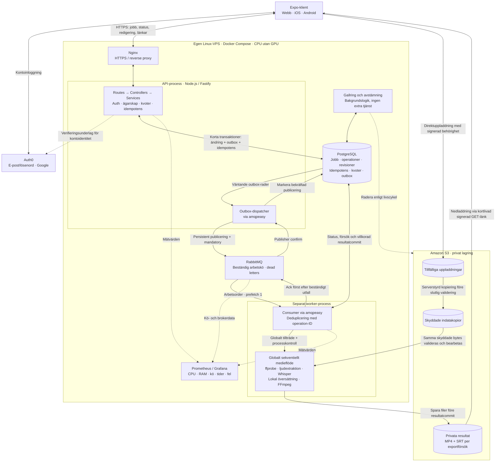

# Projektplan – ClipScribe

Status: planering pågår. Öppna frågor är inte godkända beslut.

## Underlag och prioriteringar

- `uppgift.md` är examinationsunderlag.
- `prelplan.md` är en preliminär arkitekturskiss, inte låsta teknikval.
- Enkel, ren, säker och lättunderhållen kod prioriteras.
- Användarens RabbitMQ-bibliotek `amqpeasy` ska användas: https://github.com/siensky/amqpeasy. Version och gränssnitt ska granskas innan integrationsdesignen fastställs.
- Ingen implementation påbörjas i denna planeringsomgång.

## Obligatoriska krav

- HTTP-API för uppladdning, jobbstatus och nedladdning.
- Validering av filformat, filstorlek och videolängd; högst 60 sekunder.
- Lokal AI-transkribering utan externa AI-API:er eller betalda transkriberingstjänster.
- Nedladdningsbar SRT och MP4 med permanent inbrända undertexter.
- Högst en video bearbetas samtidigt, inklusive transkribering och inbränning.
- Kontrollerad hantering av samtidiga anrop, fel och temporära filer.
- Driftsättning på egen Linux-VPS utan GPU, med hänsyn till CPU, RAM och lagring.

## Bekräftad omfattning och förutsättningar

- Samtliga bonusfunktioner ska ingå: frontend, konton/gästbegränsning, jobbkö, rate limiting, Docker och övervakning.
- Målet är främst portfolio; mycket låg faktisk användning förväntas, men lösningen ska fungera i drift.
- Första versionen ska stödja webb, iOS och Android; mobilapparna distribueras som testbyggen.
- Planen ska ha byggfaser och acceptanskriterier, ingen dag- eller kalenderplanering.
- Ingen VPS är inköpt. Välj senare den billigaste lösningen som klarar uppmätta resurs- och kvalitetskrav utan GPU.
- AWS/S3 och Auth0 finns redan och är tillåtna enligt användaren.
- Flera talade språk ska stödjas med automatiskt och manuellt språkval.
- Inloggade får 24 timmars lagring. Gäster får tillfällig åtkomst enligt produktbesluten nedan.
- Utgångsstacken behålls: React Native/Expo, Node.js/Fastify, PostgreSQL med SQL, Auth0, RabbitMQ/amqpeasy, S3, Whisper, FFmpeg, Docker Compose, Nginx samt Prometheus/Grafana. Byten ska ha konkreta motiveringar och diskuteras först.

### Bekräftade produktbeslut

- Webb, iOS och Android ingår i första versionen. Mobilappar distribueras som testbyggen, inte genom publicering i appbutiker.
- Automatisk språkidentifiering med möjlighet till manuellt språkval.
- Manuell undertextredigering och översättning ingår. Målspråk för översättning är svenska och engelska. Lokal översättningsmotor och stödda källspråk för översättning återstår att verifiera.
- Redigeraren tillåter ändring av text, starttid och sluttid samt att lägga till och ta bort segment. Avancerad tidslinje, delning och sammanslagning ingår inte i första versionen.
- Undertexterna har en fast läsbar stil; ingen utseenderedigering i första versionen.
- Uppladdning: MP4 och MOV, högst 60 sekunder, 100 MiB och 1080p, inklusive stående video. 4K avvisas. Exakt codec- och bildfrekvensstöd samt validering av upplösning verifieras med representativa mobilklipp.
- Flödet är uppladdning → transkribering → granskning/redigering/valfri översättning → användaren väljer Skapa video → inbränning och nedladdning. Ingen automatisk första inbränning.
- Granskning håller inte workern upptagen. Översättning och nya inbränningar ska också omfattas av serverns begränsning av tung bearbetning.
- Gäster får också redigera och översätta, med separat begränsning av resursförbrukning.
- Högst ett aktivt jobb per gäst och tre per konto. Aktiva jobb omfattar uppladdning, kö, bearbetning och redigeringsutkast. Färdiga resultat räknas mot lagringsgränsen men inte som aktiva; ny bearbetning av ett färdigt resultat kräver en ledig aktiv plats. Globala kö- och lagringsgränser tillkommer.
- En gäst får hämta både MP4 och SRT för ett jobb under sin timkvot; nästa jobb blockeras. Nya redigerade versioner av samma jobb omfattas av samma rättighet. Exakt kvotstart och tekniska omförsöksregler återstår.
- Gästens tillfälliga åtkomst gäller en timme från färdig transkribering, med tydlig nedräkning och möjlighet att logga in för 24 timmars lagring. Gallringsbeteende vid pågående eller köad bearbetning behöver specificeras.
- Original eller en ren mellanfil behålls så länge ny inbränning tillåts.
- Gästjobb ska kunna övertas av användarens konto vid registrering eller inloggning, med verifierat ägarskap.
- Gäster identifieras genom en hemlig serverutfärdad gästsession. Timkvoten lagras och kontrolleras atomiskt på servern per gästsession. Ingen e-postverifiering krävs för gäster och ingen strikt nedladdningskvot delas per IP.
- IP används endast som kompletterande missbruksskydd för exempelvis hög takt av sessionsskapande, uppladdningar och tunga operationer, aldrig som bevis på jobbägarskap. Globala kö- och lagringsgränser skyddar servern oberoende av identitet.
- Gästkvoten överlever siduppdatering men kan kringgås genom att skapa en ny gästsession. Systemet utlovar inte en kvot per unik fysisk person. Personer på samma nät får egna nedladdningskvoter, men kan påverkas av gemensamma skydd mot överbelastning.
- Auth0 används för både e-post/lösenord och Google-inloggning. Verifierad e-post krävs för utökade kontogränser; leverantörens verifieringsuppgifter ska valideras.
- Kontosidan visar privata jobb med fortsatt redigering, nedladdning och manuell radering. Publik delning ingår inte.
- Originaltext bevaras och översättning är ett separat redigerbart alternativ. Användaren väljer undertextspråk för export. Ändras originaltexten efter översättning markeras översättningen som potentiellt inaktuell; manuella ändringar skrivs inte över automatiskt.
- Inloggade får 24 timmars lagring från färdig transkribering. Vid övertagande av ett giltigt gästjobb gäller 24 timmar från övertagandet. Redigering förlänger inte lagringstiden. Övertagande före färdig transkribering måste preciseras i tillståndsmodellen.
- Användaren har uppdaterat amqpeasy. Version 0.2.0 är publicerad och dess dokumentation/pakettyper har kontrollerats 2026-10-25. Nödvändiga API-inställningar finns; projektets integrationstester återstår.

## Förslag att ta ställning till

De godkända strategierna för HTTP-idempotens, SQL-transaktioner, transactional outbox, deduplicering via operation-ID, worker, S3 och återhämtning finns i [teknisk-strategi.md](teknisk-strategi.md). Direktuppladdning fryses till skyddad kopia före slutlig validering. Nedladdning använder kortlivade signerade länkar med accepterat begränsat återkallningsbeteende. Strategierna ska konkretiseras till kontrakt före implementation; faslistan ensam är inte en färdig systemdesign.

- Efter plangranskningen är gästkvoten uttryckligen bekräftad oförändrad. Ingen ny beslutsrunda om filkvot krävs.
- Val av VPS och total resursmätning behöver inte avgöras nu. De kvarstår som verifiering före driftsättning.

- Expo för gemensam frontend, med små plattformsspecifika delar för autentisering, filval och filhämtning. Testa de kritiska flödena på webb och mobil tidigt.
- Utvärdera Whisper-runtime för CPU (exempelvis whisper.cpp) och modellstorlek i första fasen. Inga prestandalöften före mätning.
- Föreslagen kvotstart: första atomiskt beviljade nedladdningsåtkomsten, med 60 minuters spärr för andra jobb. Omförsök för samma jobb förbrukar ingen ytterligare kvot. Detta är projektets valda tolkning av examinationens nedladdningsregel.

## Nästa beslutsomgång: produktgränser

Följande är rekommendationer, inte fastställda gränser:

- Högst en köad eller körande operation per jobb. Global kö- och lagringsgräns sätts efter resurstest.
- Spara ändringar uttryckligen, översätt en sparad version, bevara originaltexten och låt användaren välja original eller översättning för export. MP4 och SRT ska alltid motsvara samma oföränderliga undertextversion.
- Gästsessionens lagring på webb och mobil, livslängd och överföring till konto ska specificeras i autentiseringsdesignen. CAPTCHA är inte ett beslutat krav.

## Beslutsordning

1. Omfattning, målgrupp, budget och VPS-resurser.
2. Webb kontra mobil, externa tjänster och låsta teknikval.
3. Användarflöden, ägarskap, gästidentitet och betydelsen av en nedladdning.
4. Filgränser, språk, undertextutseende, lagring och gallring.
5. Systemgränser, uppladdningsflöde och global begränsning till en bearbetning.
6. Databasschema, tillståndsövergångar, transaktioner och migreringar.
7. Autentisering, behörighet, nedladdningskontroll och missbruksskydd.
8. amqpEasy, meddelandekontrakt, publicering, kvittenser, dubbletter och återförsök.
9. API-kontrakt, felmodell och frontendbeteende.
10. Tester, drift, återställning, verifierbara acceptanskriterier och byggfaser.

## Risker som planen måste lösa

### Uppdaterad amqpeasy-granskning – 0.2.0

Kontrollerat 2026-10-25: repositoryts README, npm-registrets latest (0.2.0), publicerade typdeklarationer och publiceringsmodul. Paketet har inte installerats eller körts här. Ingen fullständig kodrevision eller brokerintegration är genomförd.

- `publish.confirms`, `persistent`, `mandatory` och `timeoutMs` finns. Tillförlitlig publicering måste aktiveras uttryckligen; standardvärdena ger fortfarande inte dessa garantier.
- `subscribe.durable` och `prefetch` finns. Vi använder prefetch 1, tillsammans med projektets separata globala processkydd.
- `disconnect({ timeoutMs })` dokumenteras stoppa nya leveranser och dränera aktivt arbete. Handlers får AbortSignal; externa processer måste fortfarande stoppas av vår processkontroll.
- `status`, `onStatusChange` och manuell `connect()` finns för kontrollerad återanslutning. Projektet ansvarar för backoff och att inte återansluta under avsiktlig shutdown.
- Med `deadLetter: false` lämnas kastade handlerfel okvitterade; prefetch 1 kan då stoppa nya leveranser tills kanalen stängs. Återhämtningsstrategin måste uttryckligen hantera detta. `deadLetter: { maxRetries: 0 }` är ett dokumenterat alternativ för karantän utan bibliotekets verksamhetsåterförsök; exakt val återstår i meddelandekontraktet.
- Outbox, idempotens, återförsök i applikationen och kvittens först efter beständigt utfall behövs fortsatt. Stabilt messageId/operationId skickas i vår payload; bibliotekets interna publicerings-ID ersätter inte dem.

Slutsats: de tidigare efterfrågade API-funktionerna finns dokumenterade och i paketets typer. Planera integration mot exakt 0.2.0, med slutlig låsning och kontraktstester i fas 1. Se teknisk-strategi.md för ansvarsfördelningen.

### Applikationsrisker

- Databasskrivning och köpublicering får inte lämna accepterade jobb bortglömda.
- Dubbelleveranser och omstarter får inte ge parallell bearbetning eller felaktiga resultat.
- Begränsning till en worker är inte i sig ett fullständigt bevis på global samtidighetskontroll vid återstart och driftsättning.
- Uppladdning och medieinspektion kräver egna resursgränser även när bearbetningen är sekventiell.
- Gästnedladdningar måste definieras för två resultatfiler, omförsök och avbrutna överföringar.
- Kökapacitet, lagringsbudget och gallring måste vara begränsade.
- CPU-prestanda och transkriptionskvalitet måste mätas på representativa klipp.
- Tester minskar risk; de kan inte garantera felfri produktion.

## Systemdesign

Ritningen visar den beslutade systemindelningen. PostgreSQL är sanningskälla, RabbitMQ transporterar arbetsorder och S3 lagrar privata filer. Alla AI-modeller körs lokalt på VPS:ens CPU. Exakta auth-flöden, tabellscheman och processlås konkretiseras enligt teknisk-strategi.md.



**Så läses ritningen:**

- Klienten begär uppladdnings-/nedladdningsbehörighet från API:t. Filöverföringen går direkt till/från S3; klienten får aldrig generella AWS-nycklar eller skrivåtkomst till skyddade kopior.
- Kopieringspilen i S3 är en serverstyrd åtgärd, inte ett automatiskt S3-flöde. En lyckad kopia binds till jobbet innan slutlig medievalidering; omförsök får inte skriva över vald indata.
- API:t sparar en arbetsbegäran och outbox i samma transaktion. Dispatchern är en loop i API-processen, inte en separat mikrotjänst. Meddelanden innehåller identifierare, inte videofiler.
- Workern kör bara en medieoperation åt gången, inklusive inspektion och förberedelser. Granskning/redigering i klienten upptar inte workern. Prefetch kompletteras med skydd mot överlappande och efterlevande processer.
- Resultaten är privata även efter S3-uppladdning. Både MP4 och SRT blir tillgängliga som ett färdigt resultat först efter lyckad DB-commit. Länkar utfärdas efter ny behörighets-/kvotkontroll.
- Auth0 används för konton. Gäster identifieras av serverutfärdad gästsession. Ritningen låser inte det återstående valet av webbsession-/tokenflöde.
- Gallring/avstämning är befintlig backendlogik; exakt processplacering fastställs i driftkontraktet. Streckade pilar visar stödflöden, inte nya publika endpoints. Databas, broker och övervakningsgränssnitt är interna.

### Transaktion och meddelandeflöde vid export

```mermaid
sequenceDiagram
    autonumber
    participant C as Klient
    participant A as API
    participant D as PostgreSQL
    participant O as Outbox-dispatcher
    participant Q as RabbitMQ
    participant W as Worker
    participant S as Privat S3

    C->>A: Skapa video (Idempotency-Key, undertextrevision)
    A->>D: BEGIN; kontrollera identitet/ägarskap, nyckel, status och kapacitet
    A->>D: Spara operation, outbox och idempotensresultat
    A->>D: COMMIT
    D-->>A: Commit bekräftad
    A-->>C: 202 + samma operation-ID vid identiskt omförsök
    O->>D: Läs väntande outbox
    O->>Q: Publicera persistent meddelande via amqpeasy
    Q-->>O: Confirm (routningsfel måste också hanteras)
    O->>D: Markera publicerat
    Q->>W: Leverera operation-ID
    W->>D: Kontrollera status och reservera aktuellt försök
    Note over W: Globalt tillträde före mediebearbetning; deduplicera och kontrollera aktuell status
    W->>S: Hämta skyddad indata
    Note over W: Rendera vald oföränderlig undertextrevision
    W->>S: Spara MP4 och SRT på försöksspecifika nycklar
    S-->>W: Båda filerna lagrade
    W->>D: Kort transaktion: kontrollera försök/jobblivscykel och publicera båda resultat
    D-->>W: Commit bekräftad
    W->>Q: Ack
    C->>A: Begär resultatlänkar
    A->>D: Kontrollera ägare, utgångstid och bevilja kvot atomiskt
    A-->>C: Kortlivade signerade S3-länkar
    C->>S: Hämta MP4 och SRT
```

Sekvensen visar lyckad väg. Vid krasch efter commit men före svar/kvittens återanvänds idempotensnyckel respektive operation-ID. Vid publicering utan säker bekräftelse försöker dispatchern igen; dubbletter är förväntade. S3-anrop och CPU-arbete hålls utanför SQL-transaktionerna. Felvägar, avstämning och cleanup specificeras i teknisk-strategi.md och teststrategi.md.

## Byggfaser

Monorepots struktur, entrypoints, ansvar för routes/controllers/services/repositories/schemas/mappers/types, BaseError-hierarki och enhetlig kodstil definieras i [repostruktur.md](repostruktur.md). Dessa regler införs med projektgrunden i fas 2 och gäller därefter för alla ändringar.

Testernas omfattning, scenario-ID:n, verktygsförslag, körprofiler och fasgrindar finns i [teststrategi.md](teststrategi.md). Enhets-, integrations- och komponenttester kompletteras av en omfattande E2E-svit; denna byggs löpande från fas 2 och omfattar hela produkten i fas 4–5.

Den detaljerade fasplanen finns i [byggfaser.md](byggfaser.md). Den definierar leveranser, avgränsningar, verifiering och överlämning för varje fas.

1. Lås kontrakt och verifiera tekniska risker.
2. Bygg en säker kedja från uppladdning till undertextutkast.
3. Färdigställ redigering, översättning och export.
4. Slutför användarflöden, kvoter och livscykel på alla plattformar.
5. Verifiera och driftsätt hela systemet på Linux-VPS.

Ordningen är avsiktlig: datakontrakt och risker före produktimplementation, ägarskap och tillförlitlig kö före tunga jobb, därefter fullständigt medieflöde och produktregler. Frontend, tester och driftförberedelser byggs löpande. Ingen fas är genomförd ännu och öppna beslut blir inte godkända genom att placeras i en fas.
